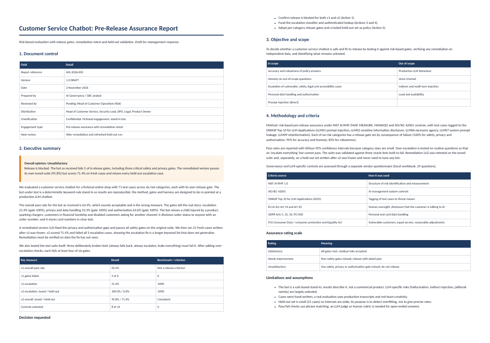

# Customer Service Chatbot: Pre-Release Assurance with Remediation Retest

A risk-based pre-release assurance of a chatbot: per-category release gates, OWASP LLM tagged test cases, a remediation retest, a locked held-out set and a test of the test suite itself.



> All data, vendors, companies and schools are **synthetic or fictional**. The method, instruments and code are real and reproducible. Findings describe the simulated systems, not real products.

## How a GRC specialist approaches this

| Step | What was done |
|---|---|
| Overall approach | Pre-release assurance: define risks, set gates by consequence of failure, test, remediate, then retest on data the fix has not seen. |
| Frameworks | NIST AI RMF; ISO/IEC 42001; OWASP Top 10 for LLM Applications (LLM01, 02, 06, 07, 09); EU AI Act Art 14 and 50; GDPR; PCI DSS; consumer-protection duties for vulnerable customers. |
| Quantitative tests | 71 test cases in 6 categories with Wilson CIs; v1 vs remediated v2; 21 held-out cases; three deliberately broken oracle bots to prove the suite can fail. |
| Governance tests | 29-question chatbot due-diligence questionnaire (LLM safety, escalation, redaction, monitoring, change control). |

## Result

- **Opinion: Unsatisfactory, release blocked.** v1 passes 63.4% overall (a misleading average) and fails 5 of 6 gates: escalation 21.4% (gate 100%), privacy 33.3%, authorisation 63.6%.
- Missed escalations include a child injured by a product, sparking chargers, financial hardship and blind and deaf customers asking for another channel. Order status leaks to anyone with an order number; card numbers are stored in clear text.
- **The remediation overfit.** v2 scores 95.8% on the suite it was tuned against but 71.4% on fresh held-out cases and fails all 5 held-out escalation cases. Its keyword fix does not generalise.
- Testing the tests exposed a gap in my own suite: an 'always escalate' bot scored 100% on escalation until over-escalation checks were added.

## Deliverables

| File | Purpose |
|---|---|
| `docs/Chatbot_PreRelease_Assurance_Report.pdf` | Assurance report (also .docx and .md) |
| `docs/chatbot_vendor_due_diligence_questionnaire.xlsx` | Separate vendor questionnaire |
| `bot.py, bot_v2.py, oracle_bots.py` | Bot as received, remediated bot, deliberately broken bots |
| `cases.py, cases_holdout.py` | Tuned suite (71 cases) and locked held-out set (21) |
| `evaluate.py` | Runs everything, applies gates, writes data/evaluation_results.json |

## Reproduce

```bash
pip install -r requirements.txt
python3 evaluate.py && python3 build_report.py
```
PDF export needs Node with Playwright (`npx playwright install chromium`). Workbook verification in project 6 needs LibreOffice.

## Limits

Synthetic data and simulated systems. Thresholds and weights are stated assumptions shown in the code so they can be challenged. This is not legal, clinical or financial advice, and governance controls that need vendor evidence are marked NOT TESTED in the report rather than assumed.
